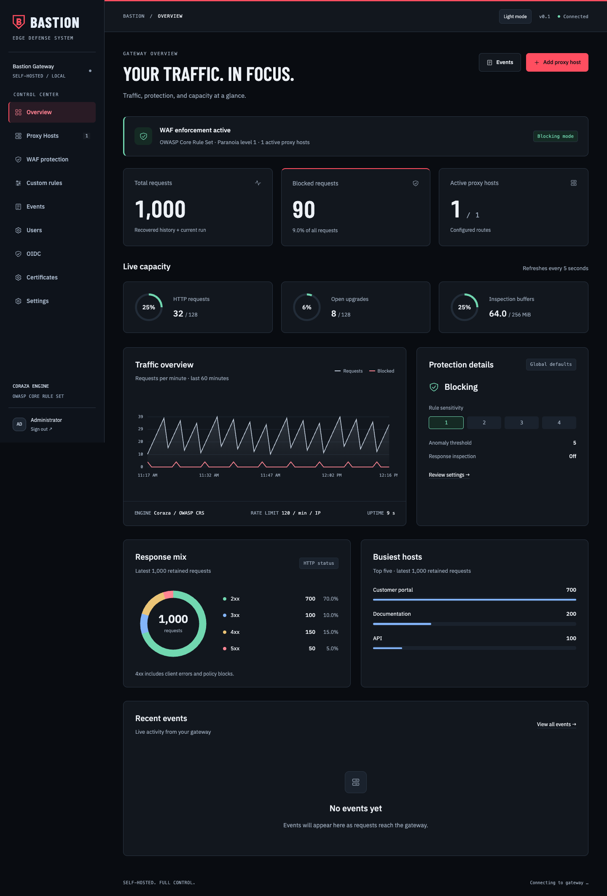
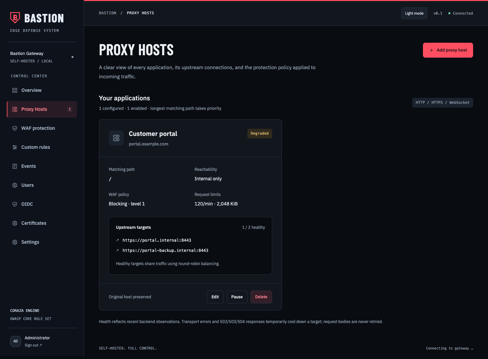
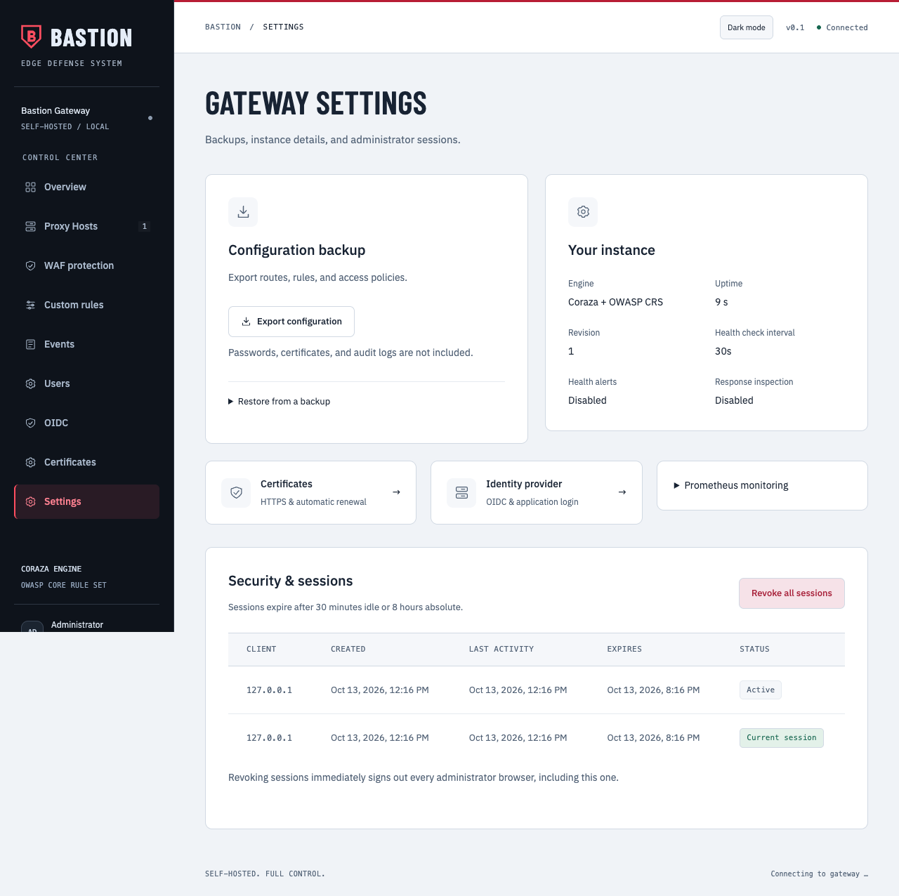
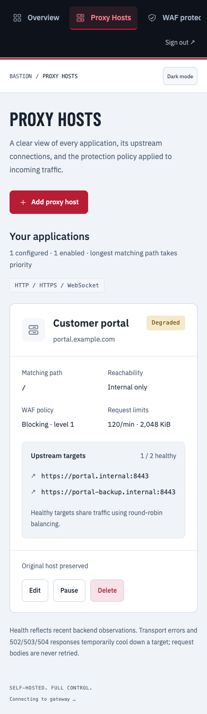

# Bastion WAF

An integrated HTTP gateway for a **separate Linux LXC running Docker**. The reverse proxy, Coraza WAF, OWASP Core Rule Set, and English administration UI run in **one process and one container**. No additional Nginx or Traefik instance is required.

```text
Internet / clients → LXC :80 / :443 → Bastion → HTTP(S) applications on the internal network
Administrator → SSH tunnel / management network → LXC :9090 → Bastion Admin
```

## Quick start

With Docker Engine, Docker Compose v2, Bash and OpenSSL installed in your Linux
LXC, run these commands in the cloned repository:

```sh
bash setup.sh                  # Guided installation and startup
# Later, if you forget the administrator password:
bash setup.sh --reset-password
```

The wizard lets you choose or generate a password and prepares the required files
and permissions. Use a terminal account that can access Docker and use `sudo`
for file ownership (or run as root inside the LXC).
See [Start in the LXC](#start-in-the-lxc) for details and
[Admin access](#admin-access) for the SSH tunnel and first login.

## Interface preview

Example views of the administration UI, captured from the browser test fixture
with synthetic traffic and example hostnames. These are illustrative screenshots,
not production traffic or performance benchmarks. Dark and light themes are included.

**Dashboard** — traffic history, response distribution, busiest hosts, and live capacity.



<details>
<summary>Proxy hosts, settings, and mobile views</summary>

**Proxy hosts** — backend health, inherited protection settings, and request limits.



**Settings** — configuration backups, instance details, and administrator sessions.



**Mobile** — the same host details and controls on a narrow screen.



</details>

## Status

This is the first functional release, not a promise of complete enterprise-WAF parity. It uses real Coraza transactions with OWASP CRS rather than handwritten regex lists. Integration tests cover blocking before backend access, body forwarding, response inspection, TLS verification, WebSockets, access control, authentication, and configuration changes. Tune the rules for your applications and perform load and security testing in the target environment before production use.

## Included

- Responsive English GUI: dashboard, proxy hosts, WAF protection, custom rules, events, and configuration export/import.
- Exact host routing and longest matching path prefix with path-segment boundaries; routes can be disabled or deleted.
- HTTP/HTTPS upstreams with certificate verification, optional original Host header, health-aware round-robin balancing across up to 16 backends per route, active bounded HEAD checks, and optional health-change webhooks. Transport failures, active checks returning 5xx, and 502/503/504 responses temporarily cool down the selected target; request bodies are never retried.
- WebSocket upgrades; the HTTP handshake is inspected and frames are passed through after the upgrade.
- TLS 1.2+, manual PEM certificates, or automatic Let's Encrypt certificates for enabled hosts.
- Coraza **3.8.1** and CRS package **4.25.0**, pinned in `go.mod`/`go.sum`.
- SQLi, XSS, traversal, command injection, and other CRS categories, including query, header, JSON, form, and multipart inspection.
- Blocking/Detection Only, paranoia levels 1–4, anomaly threshold, and targeted CRS exclusions per route.
- Custom path, query-string, header, body, User-Agent, and method rules using bounded literal case-insensitive substrings; rules can block or log before forwarding. OWASP CRS remains the primary SQL injection, XSS, traversal, and command-injection detector.
- Custom rules can be tagged with an OWASP Top 10:2025 category (A01–A10). The WAF protection page shows a configuration coverage view for access control, misconfiguration, supply-chain, cryptography, injection, design, authentication, integrity, logging, and exceptional-condition controls. This is an operational mapping, not a certification.
- IPv4/IPv6 CIDR deny list (blacklist) and optional allow list (whitelist), globally and per route. Deny rules take precedence; a route list can only narrow the global policy, and allowed clients still pass through the WAF.
- Per-route reachability: **internal and external**, **internal only**, or **external only**. Internal clients default to RFC 1918, 100.64.0.0/10, loopback, link-local, and IPv6 ULA ranges; the WAF protection page can replace these with your own networks. Classification uses the TCP peer address, so it only works when NAT in front of Bastion preserves client IPs.
- Geoblocking by ISO country code (deny list and optional allow list), globally and per route, using a MaxMind-compatible country database (`BASTION_GEOIP_DB`). Internal clients are never geoblocked; with an allow list, public addresses without a known country are rejected. Event entries record the client country. New configuration containing geoblocking is rejected while no database is loaded. If the database is missing or invalid on restart, the dashboard remains available and public requests requiring country checks receive HTTP 503. Restore the database and restart, or remove the country rules through direct admin access.
- Fixed-window per-IP/per-route rate limiting, body limits, timeouts, connection limits, and bounded inspection buffers.
- Each route may override WAF mode, paranoia, anomaly threshold, rate/body limits, allowed methods, and denied bot user-agent patterns. Empty/zero overrides inherit the global setting.
- Routes can enforce an allowlist of request media types, require valid `Content-Type` headers for body methods, and add browser security response headers (`nosniff`, Referrer-Policy, Permissions-Policy, CSP frame protection, and conditional HSTS).
- Route rate and body limits can only be stricter than (or equal to) the global limits, preventing a route policy from bypassing product-wide hard limits. Method and bot restrictions are enforced before WAF inspection and recorded in the audit stream.
- Optional response inspection for MIME types supported by Coraza before data is sent to the client.
- Events with request ID, CRS IDs, IP, host, path, status, and duration; JSON export and rotating JSONL files.
- Password login, HttpOnly/SameSite cookies, CSRF and Origin checks, login limiting, idle/absolute session expiry, session revocation, and protected Prometheus metrics. The Settings page exposes active administrator sessions and a revoke-all control.
- Optional generic OpenID Connect login stores mapped users and `admin`/`viewer` roles in SQLite (`data/users.db`). Enable it with the `BASTION_OIDC_*` settings in `.env.example`; administrators may change configuration while viewers are read-only. Routes with `"oidcProtected": true` can require OIDC and receive `X-Authenticated-User` and `X-Authenticated-Role` headers. Password login remains available as a fallback.
- Local users can be created and managed through the admin API (`POST /api/users`, password changes at `POST /api/users/{subject}/password`, and role/delete endpoints). Local credentials use bcrypt hashes, are labeled `local`, and existing SQLite user databases are migrated in place.
- The GUI also exposes OIDC and certificate management. OIDC settings and Cloudflare/ACME settings are stored in the protected SQLite database; secrets are write-only and never returned. Uploaded PEM certificates and keys are validated as a matching, non-expired leaf pair and stored under `data/certificates` with mode 0600. Changes report `restartRequired`; a process restart is required before TLS/OIDC runtime configuration changes take effect.
- Atomic configuration persistence and activation without restart; revisions prevent concurrent overwrites.

## Start in the LXC

Prerequisite: a Linux LXC with a working Docker Engine and Compose v2. The LXC needs network access to backends and public registries/Go modules during the build. Docker inside the LXC requires the virtualization host to provide the required container support. Review host-specific LXC settings with the operator; blanket AppArmor or firewall disabling is not required.

As a starting point, use 2 vCPUs and 2 GiB RAM for the LXC, with extra build capacity. Compose limits the service to 1 GiB RAM and 2 CPUs; measure actual capacity with your own traffic.

In the cloned project, run the guided setup:

```sh
bash setup.sh
```

The wizard checks Docker, creates the required directories and `.env`, asks whether
private-network backends are needed, and builds/starts the gateway. Choose your
own admin passphrase (at least 20 characters) or press Enter to generate one.
Generated passwords are displayed once in the terminal; save yours in a password
manager. File permissions and container ownership are handled automatically
(`sudo` may be required for ownership). No manual `openssl`, `chown`, or `.env`
editing is needed for the default SSH-tunnel setup. Docker Compose v2 with
`up --wait` support is required.

Running the wizard again preserves your `.env`, password, routes, users and
certificates. It rebuilds/recreates the container and waits for a healthy admin
listener. This briefly interrupts traffic and signs out existing sessions.

Forgotten admin password? Run on the LXC:

```sh
bash setup.sh --reset-password
```

Choose a replacement; the wizard recreates the container to activate it. Managed
user passwords are unchanged. For day-to-day use, you can also create a named
administrator under **Users** and manage its password there.

The bootstrap admin password lives in `secrets/admin_password.txt`, readable by
container UID 10001. It is not written into the image or `config.json`; there is
no default password. To sign in with it, leave **Username** empty.

If setup reports that Docker is unavailable, start Docker and ensure your terminal
account can access it, then rerun the wizard. If startup fails or the health check
times out, inspect `docker compose logs --tail=100 bastion`. Fix the reported
configuration error and rerun `bash setup.sh`; your saved settings are retained.
For an existing installation, edit `.env` directly to change network settings—the
wizard only asks about private backends when creating a new `.env`.

<details>
<summary>Manual installation / automation</summary>

```sh
mkdir -p secrets certs geoip
chmod 700 secrets
umask 077
openssl rand -hex 32 > secrets/admin_password.txt
# Save the generated password in your password manager before changing ownership.
cat secrets/admin_password.txt
sudo chown 10001:10001 secrets/admin_password.txt
sudo chmod 400 secrets/admin_password.txt
cp .env.example .env
docker compose up -d --build --wait
```

Set `BASTION_ALLOW_PRIVATE_UPSTREAMS=true` in `.env` if your backends are on your
private network. The admin origin defaults to empty for direct/tunnel access.

</details>

The data volume is initialized with UID 10001 on first start and persists across container restarts.

### Admin access

By default, the published admin port binds only to **127.0.0.1 inside the LXC**. From your workstation:

```sh
ssh -L 9090:127.0.0.1:9090 your-user@LXC-IP
```

Open [http://localhost:9090](http://localhost:9090) and sign in with the secret. The tunnel encrypts transport. For direct management-network access, set `BASTION_ADMIN_BIND` to the internal LXC address. The admin listener is HTTP-only in this release, so use SSH/VPN access and never expose port 9090 to the Internet. It is **not** a path on the public proxy listener.

To serve the admin UI through a TLS reverse proxy such as Zoraxy, publish the admin port on the LXC management interface, set `BASTION_ADMIN_ORIGIN=https://web.cyberpotato.ch`, `BASTION_ADMIN_SECURE_COOKIE=true`, and proxy that hostname to `http://LXC-IP:9090`. Keep the admin hostname restricted to the management network. The container image defaults the admin listener to loopback; set `BASTION_ADMIN_ADDR=0.0.0.0:9090` only when a container or reverse proxy must reach it.

### First application

1. Open **Proxy Hosts → Add proxy host** and enter a name.
2. Enter a domain such as `cloud.example.com` and path `/`.
3. Enter a backend such as `http://10.20.0.15:8080`. `localhost` means the Bastion container, not another LXC.
4. Enable and save the route.
5. Point the domain DNS at the gateway and forward only ports 80/443 to the LXC.

Before changing DNS:

```sh
curl -i -H 'Host: cloud.example.com' http://LXC-IP/
curl -i -H 'Host: cloud.example.com' 'http://LXC-IP/?q=%3Cscript%3Ealert(1)%3C%2Fscript%3E'
```

In blocking mode, the second request should return 403 and the UI should show the rule match. Test only against an application you control.

## HTTPS

**Let's Encrypt:** Set a real `BASTION_ACME_EMAIL` in `.env` and run `docker compose up -d`. ACME and HTTP-to-HTTPS redirects are then enabled. Domain DNS and ports 80/443 must point to this LXC from the Internet. Certificates are requested only for enabled hosts and cached/renewed under `/data/acme`. Unknown hosts receive no certificates.

DNS-01 certificate requests run in the background, so an unreachable ACME/DNS provider does not block the dashboard. HTTPS handshakes fail until a certificate is available; HTTP keeps redirecting to HTTPS. Failed requests retry after one minute with exponential backoff up to one hour, and each attempt is limited to five minutes. Check container logs for issuance errors; dashboard health alone does not confirm that HTTPS is ready. Invalid local TLS configuration can still prevent startup.

**Wildcard certificates with Cloudflare DNS-01:** Set a scoped Cloudflare API token with `Zone:DNS:Edit` for the relevant zone, then explicitly list the certificate names. This mode supports names such as `example.com,*.example.com` and does not require inbound port 80 for ACME validation:

```dotenv
BASTION_ACME_EMAIL=admin@example.com
BASTION_ACME_DNS_PROVIDER=cloudflare
BASTION_ACME_DNS_API_TOKEN=...
BASTION_ACME_DOMAINS=example.com,*.example.com
```

The account key and certificate are stored under `/data/acme-dns` and renewed automatically. Use a least-privilege token, never commit it to Git, and use `BASTION_ACME_DIRECTORY=https://acme-staging-v02.api.letsencrypt.org/directory` for safe testing. DNS propagation can delay the first issuance; startup waits for issuance so the TLS listener does not serve without a valid certificate.

**Custom certificates:** Put `fullchain.pem` and `privkey.pem` in `certs/`, make them readable by UID 10001, and set:

```dotenv
BASTION_ACME_EMAIL=
BASTION_TLS_CERT=/certs/fullchain.pem
BASTION_TLS_KEY=/certs/privkey.pem
```

Restart the container. The certificate must cover every domain in use. Manual certificates require a restart after renewal. Without ACME or PEM files, the proxy remains HTTP-only and the published 443 port has no listener.

## Geoblocking

Download a country database in MaxMind DB format, for example the free [DB-IP IP to Country Lite](https://db-ip.com/db/download/ip-to-country-lite) (CC BY 4.0) or MaxMind GeoLite2-Country (free account required):

```sh
mkdir -p geoip
curl -fsSL "https://download.db-ip.com/free/dbip-country-lite-$(date +%Y-%m).mmdb.gz" | gunzip > geoip/dbip-country-lite.mmdb
chmod 644 geoip/dbip-country-lite.mmdb
```

Set `BASTION_GEOIP_DB=/geoip/dbip-country-lite.mmdb` in `.env` and run `docker compose up -d`. Then configure blocked or allowed countries under **WAF protection → Geoblocking** or per proxy host. The database is read at startup; refresh it monthly and restart the container.

## Operating behavior and limits

- **Single instance:** configuration is stored on a local volume; rate limits, sessions, and dashboard counters are in memory. There are no distributed limits or HA synchronization. Sessions expire after 30 minutes of inactivity, eight hours absolute, or restart. The authenticated session API can list sessions and revoke them all. The JSONL archive persists in the data volume. On startup, Bastion reads the current and rotated audit files to restore the latest 1,000 events, dashboard totals, and the recent traffic chart. Damaged records are skipped with a visible recovery warning. Dashboard totals include recovered records plus the current run; after older files rotate away, their totals cannot be recovered on the next restart. Prometheus counters remain process-local and reset on restart. The Events page supports search, result filters, 50-row pages, paused live updates, and export of all matching retained events.
- **Direct edge operation:** client IP comes from the TCP peer. Forwarded, `X-Forwarded-*`, and `X-Real-IP` headers are discarded and rebuilt. There is no trusted-proxy/CDN support.
- **Uploads:** default 2 MiB per request, configurable from 1 KiB to 32 MiB. The complete request is buffered before forwarding. Compressed request bodies are rejected with 415.
- **Response inspection:** disabled by default. When enabled, inspectable MIME types are limited to 1 MiB; larger or compressed inspectable responses are rejected with 502. This is not malware scanning. WebSocket frames and gRPC messages are not inspected.
- **Capacity:** at most 128 concurrent HTTP requests plus 128 established upgraded connections, and a conservative 256 MiB payload-buffer reservation budget. Request and inspected response buffers reserve capacity incrementally as they grow (including an allowance for copies); empty bodies reserve no payload capacity. Successful upgrades release their inspection buffers and HTTP slot after the handshake. The payload budget is not a total process-memory limit. Exhaustion returns 503. This is not volumetric DDoS protection.
- **Backends:** active HEAD checks run every 30 seconds by default, with a two-second timeout and at most 16 concurrent probes. Configure `BASTION_UPSTREAM_HEALTH_INTERVAL` between 5 and 300 seconds. HTTP 2xx–499 responses count as reachable; 5xx responses and transport errors trigger cooldown. There are no automatic retries, session affinity, or URL rewrites. Private HTTP(S) backends require the explicit SSRF opt-in. Bastion is not a forward proxy.
- **Alerts:** set `BASTION_ALERT_WEBHOOK_URL` to receive a JSON POST when an active health check changes a target between reachable and unhealthy. Delivery is asynchronous, bounded to 32 queued alerts, and uses a three-second timeout. No request payloads, cookies, credentials, or WAF match data are sent.
- **Accounts:** one administrator; no roles, SSO, or MFA. Admin APIs and backend access are highly privileged.
- **Logs:** query strings, bodies, authorization headers, and Coraza match data are not retained. Paths may still contain application-sensitive values. The audit file is limited to 10 MiB plus one rotation.
- **Not included:** ASN rules, bot challenges/CAPTCHA, API-schema validation, automatic tuning, threat-intelligence feeds, caching, HTTP/3, and GUI certificate management.

## Monitoring and backup

Health check: `GET /healthz` on the admin port, without login. It checks the process/listeners, not backend health. Authenticated `GET /api/upstreams` exposes runtime target health, failure counts, cooldowns, and the last observed status/error; `/api/upstreams/status` provides the same focused status view.

Prometheus: `GET /metrics` with an admin session or a dedicated metrics token from `BASTION_METRICS_TOKEN`. Metrics include `bastion_active_requests`, `bastion_active_upgrades`,
`bastion_inspection_reserved_bytes`, and `bastion_inspection_budget_bytes` gauges.
`bastion_request_duration_seconds` is a cumulative histogram in seconds, measured
through request completion (including the lifetime of upgraded connections).
`bastion_request_failures_total{cause="..."}` separates `request_capacity`,
`inspection_capacity`, `upgrade_capacity`, `upstream_transport`, `upstream_status`
(502/503/504), `response_inspection`, `request_body` (read errors), and `geoip`.
Labels use a fixed set of causes; client IPs, URLs and request IDs are not labels.
Local capacity and response-inspection failures do not put a backend into cooldown.
The existing counters remain available; the legacy `bastion_upstream_errors_total`
counts all completed 5xx responses, including local failures. Use the cause counters
to distinguish backend failures from gateway failures.

The admin password is never accepted as a bearer token. Generate at least 32 random characters, keep the endpoint on the trusted management network, and rotate the token by restarting Bastion.

```sh
docker compose logs -f --tail=100 bastion
```

Export configuration from the GUI. For a complete restore, also protect the `bastion_data` volume, `secrets/`, `.env`, and `certs/`. Back up the volume before image updates. **`docker compose down -v` deletes the data volume.**

## Development and tests

Go 1.26 is recommended; there are no Node/frontend build dependencies. HTML/CSS/JS are embedded into the binary with `go:embed`.

```sh
go mod download
go test -race -count=1 ./...
go vet ./...
go build ./cmd/bastion
```

For local development, use `BASTION_ADMIN_PASSWORD` or `BASTION_ADMIN_PASSWORD_FILE`. Defaults: proxy `:8080`, admin `127.0.0.1:9090`, data `./data`.

Important environment variables: `BASTION_DATA_DIR`, `BASTION_HTTP_ADDR`, `BASTION_HTTPS_ADDR`, `BASTION_ADMIN_ADDR`, `BASTION_ADMIN_ORIGIN`, `BASTION_ADMIN_SECURE_COOKIE`, `BASTION_ALLOW_PRIVATE_UPSTREAMS`, `BASTION_METRICS_TOKEN`, `BASTION_UPSTREAM_HEALTH_INTERVAL`, `BASTION_ALERT_WEBHOOK_URL`, `BASTION_ADMIN_PASSWORD_FILE`, `BASTION_ACME_EMAIL`, `BASTION_ACME_DNS_PROVIDER`, `BASTION_ACME_DNS_API_TOKEN`, `BASTION_ACME_DOMAINS`, `BASTION_ACME_DIRECTORY`, `BASTION_TLS_CERT`, and `BASTION_TLS_KEY`. The built-in Docker health check expects admin port 9090.

For SSRF protection, private, loopback, link-local, and unspecified upstream destinations are rejected by default, including during connection establishment. If the WAF intentionally proxies trusted internal services, set `BASTION_ALLOW_PRIVATE_UPSTREAMS=true` and restrict the host/container network accordingly. The dashboard also supports a persistent light/dark theme toggle and follows the system preference on first use.

```text
cmd/bastion/        entrypoint, listeners, TLS/ACME, shutdown
internal/gateway/   config, Coraza, proxy, admin API, events, tests
web/static/         GUI without external CDN dependencies
compose.yaml        LXC/Docker deployment
```

References: [Coraza](https://coraza.io/docs/), [OWASP CRS](https://coreruleset.org/docs/), [Go ReverseProxy](https://pkg.go.dev/net/http/httputil#ReverseProxy), [autocert](https://pkg.go.dev/golang.org/x/crypto/acme/autocert).


### Configuration status and browser tests

OIDC and TLS pages compare saved settings with the process startup configuration.
“Saved · restart pending” means a service restart is needed; restoring the startup
values clears the notice. “Active configuration” confirms a matching configuration,
not successful certificate issuance, provider connectivity, or service health.
Changes to a manual certificate or private key are included in this comparison.

Run browser regressions with Node.js 22+, pnpm 11.25.0 and Go available:

```sh
pnpm install --frozen-lockfile
pnpm exec playwright install --no-shell chromium
pnpm test:browser
```

The test fixture builds and starts an isolated gateway on localhost ports 19091
and 18091 with temporary data and test credentials. It never uses existing
`BASTION_*` environment settings. Failed tests retain a Playwright trace and HTML
report; CI uploads these as artifacts for seven days. Traces contain test-only
credentials and must not be collected against production.

### IP exceptions and trusted proxies

Global and per-host IP whitelists restrict access; they do not bypass country rules, WAF inspection, or authentication. Separate **IP exceptions to country rules** skip country checks only: a global exception applies to all hosts, while a host exception cannot override a global country restriction. IP blacklists always win. Individual IPv4/IPv6 addresses are accepted and normalized to /32 or /128.

By default Bastion uses the socket peer address and ignores forwarded client-IP headers. Behind a reverse proxy, configure its exact address under **WAF protection → Trusted proxy IPs or networks**. Only trust proxies you control that overwrite or append `X-Forwarded-For`. Bastion walks that chain from right to left to the first untrusted hop; malformed trusted chains are rejected. Never trust arbitrary clients. This resolved address is used for application access rules, rate limits, events, WAF inspection and upstream forwarding. The separate admin listener continues to use its directly connected peer.

Keep direct management access available. Internal clients skip geoblocking according to the configured internal networks; an unconfigured private reverse proxy would otherwise make external visitors appear internal. GeoIP databases are read into memory at startup: replace the file and restart to activate updates. Geolocation is approximate and does not prove a visitor's physical location.

### Certificate dashboard

The **Certificates** page shows runtime certificate metadata independently of the
saved setup: issuer, DNS names, validity dates, age, days remaining and SHA-256
fingerprint. `Loaded` means the running process has selected that certificate;
HTTP-01 certificates found on disk are labelled `cached` until selected. This is
local TLS status, not an external DNS/firewall or browser-trust probe. Status
refreshes every five seconds without discarding edits to the setup form.

Cloudflare DNS-01 also shows the last attempt, last success, next check/retry and
request failures. **Renew certificate now** queues a background request using the
active settings; the current certificate remains available. Concurrent requests
and attempts within five minutes are rejected, and pending configuration changes
must be applied with a restart first. CA rate limits still apply. Automatic checks
request renewal only within 30 days of expiry. HTTP-01 uses autocert's automatic
renewal; manually uploaded certificates must be replaced and activated by restart.
Worker timestamps reset on restart; validity dates come from the certificate.

Before submitting a DNS-01 challenge to the certificate authority, Bastion waits
up to three minutes for the exact TXT proof to appear through both public DNS
resolvers `1.1.1.1` and `8.8.8.8`. Allow outbound UDP/TCP port 53 to these resolvers
from the container. Lookup errors and stale TXT values are retried every five
seconds; a timeout leaves validation unsubmitted and reports a DNS visibility
error in the certificate dashboard. Challenge cleanup has its own bounded timeout
so temporary TXT records can be removed even after the issuance attempt expires.
